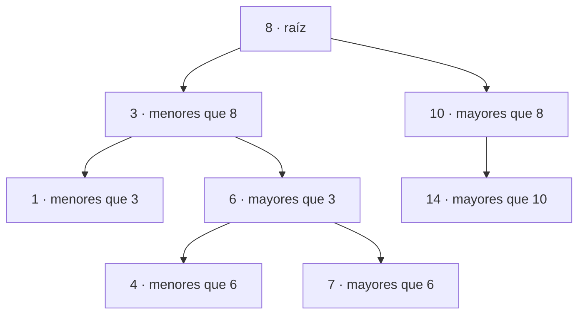

# Árbol Binario de Búsqueda (ABB)

### Exposición Final – Tercer Corte | Grupo C

[](https://isocpp.org/)
[](#-contenido)
[](#-concepto-y-funcionamiento)

---
## Integrantes

| Integrante | Código estudiantil |
| --- | --- |
| Miguel Rodríguez | T00084480 |
| Daniel Escudero | T00085014 |

| Información académica | Detalle |
| --- | --- |
| **Docente** | Gloria Bautista |
| **Asignatura** | Estructura de Datos |
| **Evaluación** | Exposición final del tercer corte |
| **Grupo** | C |

## 📖 Descripción del proyecto

Este repositorio contiene el material desarrollado para la exposición final del tercer corte, enfocada en el estudio del **Árbol Binario de Búsqueda (ABB)**. Reúne fundamentos teóricos, una implementación en C++, material de apoyo sobre complejidad y una presentación web con demostraciones visuales de inserción y eliminación.

## Contenido

1. Concepto y fundamentos del Árbol Binario de Búsqueda (ABB).
2. Aplicaciones de esta estructura de datos.
3. Análisis de complejidad temporal.
4. Análisis de complejidad espacial.
5. Simulaciones y demostraciones prácticas de su funcionamiento.

## Concepto y funcionamiento

Un ABB organiza sus valores de modo que los menores que un nodo se ubican en su subárbol izquierdo y los mayores, en el derecho. Esta propiedad permite recorrer solo una parte del árbol al buscar un valor.



El orden de inserción afecta la forma del árbol. Si queda razonablemente equilibrado, las operaciones son más rápidas; si se degenera en una cadena, pueden requerir recorrer casi todos sus nodos.

## ⏱️ Complejidad algorítmica

Sea `n` el número de nodos y `h` la altura del árbol:

| Operación o recurso | Caso promedio (árbol equilibrado) | Peor caso (árbol degenerado) |
| --- | ---: | ---: |
| Búsqueda | `O(log n)` | `O(n)` |
| Inserción | `O(log n)` | `O(n)` |
| Eliminación | `O(log n)` | `O(n)` |
| Espacio para los nodos | `O(n)` | `O(n)` |
| Espacio auxiliar por recursión | `O(h)` | `O(n)` |

En esta implementación, la altura `h` determina también la cantidad de llamadas recursivas que pueden quedar activas durante las operaciones. El documento incluido desarrolla el análisis espacial con el criterio de conteo utilizado en la exposición.

## 🚀 Simulaciones y ejecución

### Presentación interactiva (recomendada)

La demostración web está en `Diapositiva/ABB_ inserción y eliminación-4.html` y contiene visualizaciones interactivas de inserción y eliminación.

1. Abre el archivo HTML directamente en un navegador moderno; no requiere instalación de dependencias.
2. Si prefieres servirlo localmente, abre una terminal en la carpeta del repositorio y ejecuta:

   ```sh
   python3 -m http.server 8000
   ```

3. Visita `http://localhost:8000/Diapositiva/` y abre el archivo HTML listado.
4. Para detener el servidor, vuelve a la terminal y pulsa `Ctrl+C`.

### Implementación en C++

El código fuente se encuentra en `Analisis espacial y Temporal/`. Con `g++` instalado, compila desde la carpeta del repositorio:

```sh
g++ -std=c++11 "Analisis espacial y Temporal/main.cpp" \
  "Analisis espacial y Temporal/arbol.cpp" -o abb
./abb
```

El programa ofrece opciones para insertar valores, eliminar un valor y salir.

## Estructura del repositorio

```text
.
├── Analisis espacial y Temporal/
│   ├── Complejidad temporal arbolABB.docx  # Material de análisis de complejidad
│   ├── arbol.cpp                          # Operaciones del ABB
│   ├── arbol.h                            # Declaraciones de la estructura y la clase
│   └── main.cpp                           # Menú de la simulación en consola
├── Diapositiva/
│   └── ABB_ inserción y eliminación-4.html # Presentación y demostración interactiva
├── .gitignore
└── README.md
```

## Créditos y agradecimientos

Trabajo realizado por **Miguel Rodríguez** y **Daniel Escudero** para la asignatura **Algoritmos y Complejidad**. Agradecemos a la docente **Gloria Bautista** por su orientación y acompañamiento durante el desarrollo y la presentación de este proyecto.
